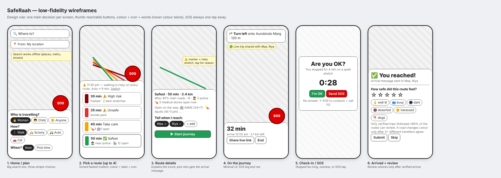

# SafeRaah — Phase 1 Blueprint

*SafeRaah* (सुरक्षित राह, "safe path") is a navigation app for India that shows up to **four routes ranked from fastest-but-riskiest to safest**, for walking, scooty/bike, auto or car, and tells your people when you reach.

## 1. Goal and principles

| Principle | What it means in the app |
|---|---|
| Safety first, honestly | Colours come from the measured risk of each route, never forced. If the fastest route is also the safest, we say so instead of painting it red. |
| Easy to use | Three choices on the home screen (who, how, when). One main decision per screen. Colour **plus** label **plus** icon (colour-blind safe). |
| Works on a cheap phone, offline | Map, routing and search run on the phone. No internet needed to plan a route. |
| Private by default | Routes are computed on the device. The server only sees a journey if you start one (for live sharing and verified reviews). |
| Never stranded | SOS is always one tap away; stops and missed arrivals trigger a check-in. |

## 2. Architecture

```mermaid
flowchart LR
  subgraph Offline data build
    OSM[OpenStreetMap extract<br/>roads, places, parks] --> P[pipeline/build-data.ts]
    OSM --> T[pipeline/build-tiles.ts]
    P --> G[graph.bin<br/>400k junctions, 533k segments<br/>+ geometry + safety features]
    P --> POI[pois.json<br/>18k places + opening hours]
    P --> S[search.json]
    T --> BM[17 basemap area packs<br/>loaded on demand]
  end
  subgraph Phone / browser  (PWA, wrapped by Capacitor for Android & iOS)
    UI[App UI<br/>MapLibre GL] <--> W[Router web worker]
    G --> W
    POI --> W
    W -->|risk R e,t| RISK[Risk model<br/>open-now, police, busy, lit, isolation, reviews]
    W -->|A* x4 alphas| ROUTES[Up to 4 tiered routes]
    UI --> JM[Journey monitor<br/>geofence, stop, overdue, off-route]
    JM --> MSG[Arrival / SOS messages<br/>SMS & WhatsApp links, call 112]
  end
  subgraph Server  (Node + SQLite)
    API[/api/journeys, reviews, crowd, share/]
  end
  JM <-->|GPS fixes, verify| API
  API -->|crowd stats per segment| W
  API --> LIVE[Live trip page for contacts]
```

### Why this shape
* **Own routing graph (Plan 1 engine)** — every segment carries its own safety features, so we fully control edge weights. GraphHopper custom models are the production upgrade path (research: `docs/research/02_tech.md`); for one city a JS A* over 144k segments answers all four routes in ~40–90 ms.
* **Hybrid "open now" (Plan 2 data)** — OSM `opening_hours` where mapped (only ~5–7% of Indian shops have it), Delhi-typical default hours otherwise (marked *estimated* in the UI). A pluggable adapter can add Google Places / Ola Maps live data when an API key is provided.
* **PWA + Capacitor** — one TypeScript codebase for web, Android and iOS. A pure PWA cannot track location in the background on iOS, so the native wrapper is required for arrival detection.

## 3. The risk model (per street segment *e*, at departure time *t*)

R(e,t) = τ(t) · [ w_open(1 − S_open) + w_auth(1 − P_auth) + w_busy(1 − C_busy) + w_lit · darkness(t) · (1 − L_lit) + w_iso · I_iso ] / Σw + w_traffic · T_child + w_crowd · U_crowd

| Term | Source | Notes |
|---|---|---|
| S_open | Places within 50 m **open at time t** (police, hospital 24×7, medical store, petrol pump, metro, shops, eateries) | Weighted by how much each place helps; liquor shops/bars count *against* safety (criminology evidence). |
| P_auth | Distance to nearest police station; metro security while metro runs | Full credit ≤150 m, fades to zero by 1 km. |
| C_busy | Road type × time of day, building density, open commerce | "Eyes on the street". Live traffic speed can be added later. |
| L_lit | Lighting prior by road type | OSM `lit=*` covers <1% of Indian roads. |
| I_iso | Parks, industrial land, lonely paths, steps/underpasses | |
| T_child | Traffic danger on big roads | Only for the *Child* profile. |
| U_crowd | Verified traveller reviews | Neutral until ≥5 distinct travellers warn (≥10 to mark safe); Bayesian average; 90-day half-life. |
| τ(t) | Hour of day | 0.35 in daylight → 1.0 late night. |

## 4. Four tiered routes

Edge cost  c_α(e) = T(e) · (1 + α · E_mode · R(e)),  α ∈ {0, 0.5, 1.5, 5}  (E_mode: walk 1.0, scooty 0.75, auto 0.6, car 0.4).

1. Run A* once per α (BFS/DFS can't do weighted shortest paths; A* with a distance heuristic is exact here because c_α ≥ T).
2. Drop near-duplicates (>85% shared length) by penalising used segments and re-searching.
3. Keep a slower route **only if it is clearly safer** (mean risk lower by ≥0.02 or worst stretch lower by ≥0.08) and at most 1.6× the fastest time — a Pareto front where *time ↑ ⇒ risk ↓*.
4. Fill up to 4 with distinct alternatives (≤70% overlap), each coloured by its own risk.
5. Colour by absolute risk: 🟥 dark red ≥0.60, 🔴 red ≥0.46, 🟡 yellow ≥0.32, 🟢 green below.

## 5. Journey, verification and SOS

* **Arrival geofence**: 10 m target, widened by GPS accuracy (15–40 m) for urban drift.
* **Arrival message**: pre-filled SMS / WhatsApp to chosen contacts (free, no DLT registration); optional server SMS gateway (Twilio/webhook) once registered.
* **Live trip link**: unguessable link contacts can open to see your latest position.
* **Check-ins**: stopped ≥4 min on a red/yellow stretch (≥10 min on green), or 10 min past ETA → "Are you OK?" with a 30 s countdown → SOS.
* **SOS**: one tap → message contacts with live link + one-tap dial 112 / 1091 / 181 / 1098.
* **Review unlock**: only if you entered the destination geofence **and** your GPS track covered ≥80% of the route, without impossible jumps or impossible speed.

## 6. Screens



1. Home / plan · 2. Pick a route · 3. Route details · 4. On the journey · 5. Check-in / SOS · 6. Arrived + review.
Plus: Contacts & settings, Safe places nearby, Live trip viewer (for contacts).

## 7. Data and coverage (this build)

* **All of Delhi NCT** — all 11 districts including New Delhi, with the bordering edges of Gurugram, Faridabad, Noida and Ghaziabad (bbox 76.83–77.35 E, 28.40–28.89 N).
* OpenStreetMap as of **31 Oct 2026** (Geofabrik Northern Zone, via a monthly-built map pack), © OpenStreetMap contributors, ODbL.
* Roads with one-way streets and names; footpaths, parks/forest, industrial land and cemeteries from OpenMapTiles vector tiles; 18,207 places (227 police posts, 863 hospitals, 994 clinics/doctors, 480 medical stores, 301 metro/rail stations, 474 petrol pumps, 7,598 shops, 3,186 eateries, 214 liquor outlets…), 1,732 with mapped opening hours.
* Building data in the tiles is sparse, so "activity" uses all mapped places, stops, schools and buildings within 50 m — the same signal everywhere, so no area is favoured by richer data from another source.
* Earlier builds covered only central Delhi (Mehrauli → Old Delhi, snapshot 15 Oct 2026, no one-way tags).

## 8. Known limits (stated in the app)

The score measures the **street environment**, not reported crime (Delhi Police does not publish geocoded incidents), and its weights are research-informed priors, not calibrated against outcomes. It supports judgement; it can't guarantee safety.
