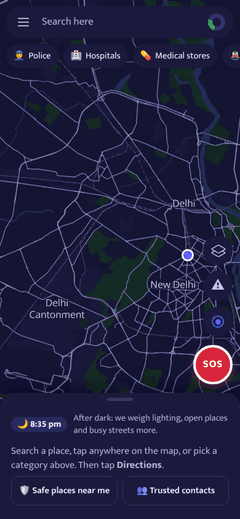
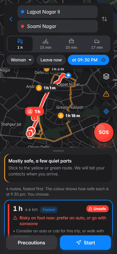
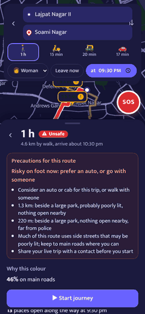
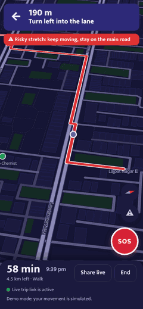
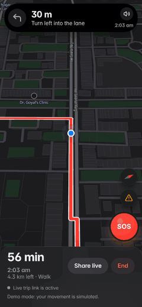
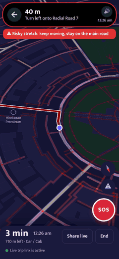

# SafeRaah — User Manual

SafeRaah works like the maps app you already know: a blue dot for where you are, a search bar, tap any place, **Directions**. What is different is the routes: for every trip you see the fastest route first and up to three safer ones, each coloured by how safe it is *right now*, with the precautions it needs. You decide which one to take.

The same six animations are inside the app under **☰ → How to use SafeRaah**.

## 1. Find a place

* **Your blue dot** shows where you are. The light-blue circle is how accurate GPS is; the cone shows which way you face. Tap **◎** (bottom right) to jump back to yourself.
* **Search here** finds metro stations, police stations, hospitals, markets, landmarks and streets — it works without internet.
* **Tap anywhere on the map** to drop a pin. The card shows the place or street, how far it is from you, whether it is open now, and how safe that street is right now.
* **Type a kind of place** — "gym", "kirana", "chemist", "salon", "cafe", "ATM", "xerox", "petrol"… — and the list shows the 5–7 nearest with **Open / Likely open / Closed**. If none of that kind is mapped nearby, it shows the closest similar places (for a gym: sports centres, sports grounds). Press Enter or **Show … on the map** to see them all as pins. It works in the start and destination fields too.
* **Category chips** under the search bar: Police, Hospitals, Medical stores, Metro, Petrol pumps — the nearest ones, with **Open / Likely open / Closed**.
* No GPS (location blocked, or indoors)? SafeRaah tells you, and **Mark where I am** lets you put yourself on the map by moving the pin.

## 2. Directions: choose a route

* On a place card tap **➤ Directions**. The start is **Your location**; tap it to search another start or **Choose on map**. **⇅** swaps start and destination.
* The tabs show the time for each way of travelling: 🚶‍♀️ walk, 🛵 scooty/bike, 🛺 auto, 🚗 car/cab. Pick yours; SafeRaah may suggest another (for example an auto late at night).
* Pick **who is travelling** (Woman, Child, Anyone) and **when** (Leave now, or a later time — the map turns dark for night trips).
* Routes are listed **fastest first**, and the fastest is selected. Each shows time, distance, a colour and a one-line precaution:
  🟥 **High risk** · 🔴 **Unsafe** · 🟡 **Take care** · 🟢 **Low risk**.
* Every route also has a label on the map with its time; tap a label or a line to select that route.
* **Precautions & steps** lists exactly what to watch for: the risky stretches by street name and why (park, nothing open, far from police, reported by travellers), whether police posts are on the way, and turn-by-turn directions.

## 3. Start the journey

* Pick who should get your **arrival message**, then tap **▶ Start**.
* The map turns to face your direction and follows you. The **island** at the top (a black capsule) shows the next turn, the distance to it and your arrival time; tap it for the step after, your progress and any quieter stretch coming up. A yellow or red ring and strip warn you while you are on a quieter stretch.
* **Voice:** SafeRaah speaks the turns like a maps app — "In 100 metres, turn left onto …", then again at the turn — and warns "Quieter stretch ahead for 300 metres. Stay alert." Tap 🔊 in the island to mute (also under ☰ → settings).
* **Android app:** the next turn also stays in your notifications and on the lock screen; on Android 16 it shows as a Live Update chip in the status bar, so you can see the next turn without opening the app.
* Take a different turn and SafeRaah **finds a new route from where you are**, keeping your choice (fastest or safest). If a clearly **safer route** appears on the way (shops closing, night falling, a new report), it offers it — you can switch or keep yours.
* **Share live** sends a link your family can open to watch your position (no app needed).

## 4. If you stop for too long

* If you stand still for 4 minutes on a risky stretch (10 minutes on a green one), or you are 10 minutes later than expected, SafeRaah asks **Are you OK?**
* Tap **I'm OK** to continue. If you do not answer within 30 seconds, SOS opens by itself.

## 5. SOS

* The red **SOS** button is always on screen.
* One tap: **Call 112**, send your location and live link to all contacts by SMS, or WhatsApp each person.
* Other helplines: **1091** Women helpline (Delhi Police), **181** Women in distress, **1098** Childline.

## 6. Arrive and review

* When you enter a small circle around the destination (10 m, wider if GPS is weak), you **arrive**. Tap **Tell … you reached** to send the message.
* Then, only if you want, two quick questions: how safe the route felt (1–5) and what you noticed. They are anonymous: your trip's location was already deleted when you arrived. Reviews are accepted only from **verified trips** — you must have actually travelled at least 80% of the route — and a street changes colour only after **5 different travellers** warn about it (10 to mark it safer).

## Live on the map
* **⚠ Report** (right side): No street lights, Deserted street, Harassment / eve-teasing, Drunk group, Someone following people, Aggressive stray dogs, or Police patrol here. You can only report where you are. Reports are anonymous, show as pins for everyone, and expire after 2–12 hours. Routes for everyone avoid the spot until then.
* Tap a report pin to say **Still there** or **Gone**. A report counts fully once a second traveller confirms it, and disappears when more people say it is gone.
* **Layers** (stacked squares): **Street safety now** colours every street in view (zoom in) by how safe it is this hour; **Live reports**; **Safe places** (filled = open now).
* Open and closed places refresh every minute.

## Menu (☰)
Safe places near me, Trusted contacts & settings (up to 5 people, kept on your phone; *Simulate my movement* to try without walking), Map layers, this guide, and one-tap calls to 112 and 1091.

## Privacy
Your location stays on your phone. During a trip it goes to the server only for the live link and the arrival check, and it is deleted the moment the trip ends. Contacts and settings never leave your phone. Full details: [10-privacy.md](10-privacy.md).

## Good to know
* Coverage: all of Delhi NCT, including New Delhi, with the bordering edges of Gurugram, Faridabad, Noida and Ghaziabad. Map data © OpenStreetMap contributors.
* Some areas have fewer shops mapped on OpenStreetMap, so "nothing open nearby" there can partly mean "nothing mapped yet". Your reviews help fix this.
* SafeRaah helps you choose; it cannot guarantee safety. In danger, call **112**.
